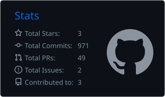
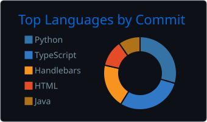

<h1 align="center">Hi, I'm Tony</h1>
<h3 align="center">ML Engineer working on AI solutioning for enterprise B2B software</h3>

  

---

### What I work on

- AI agents and generative AI applications
- Guardrails and security tooling for LLM apps
- Applied ML research

---

### Projects

| Project | Role | Stars | What it does |
|---|---|---|---|
| [**Project Aegis**](https://github.com/SAP/project-aegis) | Core maintainer |  | Open source guard pipeline for AI apps and agents. Runs pluggable validators to block unsafe content and redact sensitive data such as PII and API keys. |
| [**Fish Notes**](https://github.com/fishpain/fish-notes) | Core maintainer |  | macOS note-taking app built with Electron. |

---

### Tech stack

  
   
  

  
  
  
  

---

### GitHub stats

  
  

  

